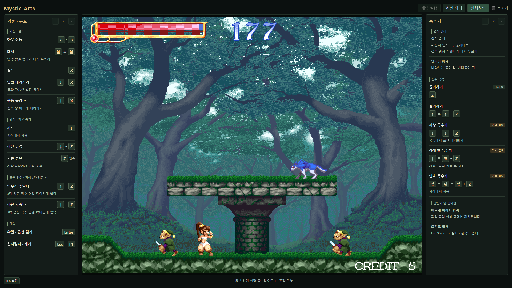
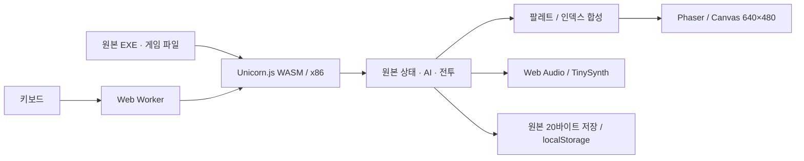

# Mystic Arts Web

**1998년 COMPILE의 Mystic Arts를 브라우저에서 실행하는 정적 웹 포팅.**

[](https://github.com/Legerdo/mystic-arts-web/actions/workflows/pages.yml)


-406e72)

### [▶ 브라우저에서 플레이](https://legerdo.github.io/mystic-arts-web/)

`게임 실행`을 누르면 원본 타이틀과 메뉴가 열립니다. 별도 설치나 게임 서버가 필요하지 않습니다. 검증 환경은 데스크톱 Chrome과 키보드입니다.



> 플레이 가능한 공개 프리뷰입니다. 모든 순간 60FPS 이상 또는 원본 Windows와 전체 캠페인 완전 동등성을 보증하지 않습니다. 확인한 범위와 남은 한계를 아래에 구분했습니다.

## 구현

원본 EXE를 새 JavaScript 게임으로 다시 작성하지 않았습니다. **원본 x86 게임 코드는 Unicorn.js WebAssembly에서, 화면은 Phaser에서 실행**합니다. Win32의 그래픽·입력·음향·파일 경계를 브라우저 기능에 연결합니다.

- 원본 타이틀, 옵션, HUD, 적 AI, 전투·콤보·스킬·피격·사망, 16라운드/엔딩 상태 코드를 실행합니다.
- 원본 640×480 팔레트 그래픽, 35개 효과음, 6개 MIDI를 사용합니다.
- 원본 16ms 게이트, SKIP 옵션, 고정소수점 연산과 정지 연출을 유지합니다.
- 검증한 8개 연산 보조 함수만 가속하며 AI·전투 상태 머신은 원본 코드가 처리합니다.
- 기술표는 게임 양옆에 표시합니다. 화면 확대, **게임만 전체화면**, Esc 복귀를 지원합니다.
- 일반 정적 HTTP(S)에서 실행합니다. 백엔드, SharedArrayBuffer, COOP/COEP 헤더가 필요하지 않습니다.



이전 BoxedWine/Wine 버전과 첫 Phaser 연습 데모는 연구 이력입니다. **배포 대상은 `phaser/native-core/dist/`**이며 로컬에 남아 있는 최상위 `dist/`와 혼동하지 마세요.

## 조작

| 동작 | 입력 |
|---|---|
| 이동 / 대시 | `←` `→` / 앞 방향을 뗐다가 다시 누르기 |
| 공격 / 점프 | `Z` / `X` |
| 가드 / 하단 공격 | `↓` / `↓ + Z` |
| 발판 내려가기 / 공중 급강하 | `↓ + X` |
| 기본 콤보 | `Z` 연속 입력 |
| 지상 3타 명중 후 연결 | `↑ + Z` 띄우기 / `↓ + Z` 하단 후속타 |
| 확인 · 옵션 닫기 | `Enter` |
| 일시정지 · 재개 | `Esc` 또는 `F1` |

특수기는 게임 옆 안내에서 확인할 수 있습니다. **`+`는 동시 입력, `후`는 순서대로 입력**입니다. 앞/뒤는 바라보는 방향 기준입니다. 기력, 피격·공격 회복, 콤보 연결 타이밍에 따라 기술이 제한됩니다. [기술표의 자료·원본 코드 대조 근거](phaser/native-core/CONTROLS.md)를 별도로 남겼습니다.

전체화면에서 Esc는 전체화면 해제에 사용됩니다. 해제 후 다시 Esc를 누르면 게임을 일시정지합니다. 게임 메뉴의 EXIT는 웹 세션을 종료하며 `게임 실행`으로 다시 시작합니다.

## 로컬 실행

준비된 정적 파일 실행에는 **Node.js 18 이상**만 있으면 됩니다. 개발/CI는 Node.js 24를 사용합니다.

```sh
git clone https://github.com/Legerdo/mystic-arts-web.git
cd mystic-arts-web
npm run preview
```

기본 주소는 **http://127.0.0.1:5173/** 입니다. 다른 포트가 필요하면 PowerShell에서 다음과 같이 실행합니다.

```powershell
$env:PORT='5175'
npm run preview
```

`file://` 대신 정적 HTTP(S)를 사용해야 합니다. 다른 서버를 쓰는 경우 `phaser/native-core/dist/`를 루트로 지정하세요. **자료 로딩 후 네트워크를 끊어도 실행이 계속되는 범위**를 검증했으며 첫 방문부터 오프라인 설치를 제공하는 것은 아닙니다.

### 소스에서 재빌드

```sh
npm run setup
npm run build
npm run verify
```

잠금 파일로 Phaser 3.90.0과 Unicorn.js 2.1.4를 설치합니다. 재빌드는 저장소에 보존한 `dist/original/`을 입력으로 사용하고 64개 원본·47개 이미지 인덱스·Unicorn 어댑터 출처를 검사합니다. 별도 원본 디렉터리로 검증하려면 다음 명령을 사용합니다.

```sh
node phaser/native-core/build.mjs --original-dir /path/to/original-game
```

원본 EXE SHA-256:

```text
285d1bb736b36ebba95e88334223f5a6851f788926961155b4e1a74f7f63296f
```

## 성능과 검증 범위

FPS는 재출력 호출 수가 아닌 **실제 캔버스 픽셀이 달라진 프레임(`changedFrameFps`)**으로 계산합니다. 아래는 Windows 11 / Ryzen 7 9800X3D / RTX 5080 / RAM 32GB / Chrome 155 Headless의 보존된 측정입니다. 다른 엔진의 동일 논리 프레임을 재생한 결정론적 A/B는 아닙니다.

| 경로 / 조건 | 실제 변경 FPS | 변경 간격 p95 |
|---|---:|---:|
| 이전 BoxedWine 기준선, 10초 ×3 | 11.01~12.13 | 113.0~117.8ms |
| Wine 루프 가속 후보, 10초 ×3 | 42.62~48.16 | 35.4~45.9ms |
| 현재 엔진, 이전 전달 빌드, 10초 ×3 | 61.46~61.76 | 25.1~25.2ms |
| 현재 엔진, 연속 플레이 10초 ×12, 1→2라운드 | 58.37~61.56 | 25.1~33.3ms |
| 현재 엔진, 16라운드 보스전 10초 ×3 | 61.06~61.46 | 25.1~25.2ms |
| 현재 엔진, MP FREE + 스킬 카메라 흔들림 반복 | 61.26 | 25.2ms |
| 공개 Pages 배포본, 1라운드 10초 ×1 | 61.07 | 25.2ms |

현재 엔진의 연속 구간 CPU 작업은 평균 **1.865ms/tick**, p95 **3.0ms**였고 최장 변경 프레임 간격은 **116.8ms**였습니다. DOM 입력부터 이동·픽셀 변화까지 **12.9ms, 1회**를 관측했으며 하드웨어 입력 지연 분포는 측정하지 않았습니다. UI/EXIT 후속 수정에 과거 성능 수치를 새 측정인 것처럼 적용하지 않습니다.

공개 Pages의 새 10초 측정은 CPU 평균 **2.110ms/tick**, p95 **3.0ms**, 최장 변경 간격 **42.4ms**였습니다. 별도 공개 브라우저 검사에서 입력→이동·픽셀 반응 **25.6ms, 1회**와 8/8 기능 통과를 확인했습니다. [공개 배포 검증](docs/PUBLICATION.md)에 빌드 해시·Actions·원시 결과를 연결했습니다. 짧은 한 구간을 장기 안정성의 증거로 확대하지 않습니다.

| 검사 | 확인한 범위 |
|---|---|
| 원본 보존 | 64개 파일 크기·SHA-256을 빌드와 배포 검증 시 검사 |
| 원본 CPU 차등 검사 | 보조 함수 396사례, 1~16라운드와 엔딩 진입 fixture의 10,200프레임 |
| 커맨드 검사 | 10개 명령 × 양 방향, 20개 실제 성공 입력 패턴 |
| 정적 브라우저 검사 | 이동·픽셀 반응, pause, 로딩 후 오프라인 실행, 원본 20바이트 저장·재로드 등 8개 항목 |
| EXIT 회귀 | 2회 종료·자원 정리·저장 보존 후 재시작 플레이 |
| 화면 구성 | 320×240~3840×2160의 10개 크기, 기술표 전체 페이지, 확대·게임만 전체화면·Esc |

차등 검사는 **동일 플랫폼 어댑터 위에서 원본 CPU와 가속 경로를 비교**한 결과입니다. 전체 Windows 동등성이나 캠페인 클리어를 뜻하지 않습니다. [검증 재현과 원시 기록](docs/VERIFICATION.md), [상세 연구 기록](phaser/native-core/README.md)을 참고하세요.

### 남은 한계

- **항상 60FPS 이상은 미달/미입증**입니다. 모든 PC·브라우저·상태에서 안정적인 30FPS도 보증하지 않습니다.
- 16라운드 정상 연속 클리어, 모든 보스 패턴·엔딩 분기와 Windows 원본의 전체 대조는 남아 있습니다.
- 콤보 마무리 → 적 벽 충돌 → 흔들림의 정확한 장면은 재현이 확정되지 않았습니다. 스킬에 의한 원본 카메라 흔들림은 별도로 검증했습니다.
- MIDI 이벤트는 원본이지만 TinySynth 음색은 Windows 장치와 다를 수 있습니다.
- 저장은 원본의 **20바이트 클리어·해금 기록**이며 중간 위치 저장이 아닙니다. 사이트 주소·브라우저별로 구분됩니다.

## 트러블슈팅

[포팅 과정과 문제 해결](docs/TROUBLESHOOTING.md)에 저속 인터프리터, Wine 레지스트리 정지 의심, x86 메모리 접근, 충돌 경계, MIDI, EXIT, 입력 포커스와 화면 크기 문제를 정리했습니다. 해결한 문제와 원인이 확정되지 않은 문제를 구분합니다.

## GitHub Pages 배포

[워크플로](.github/workflows/pages.yml)는 `main` 변경 시 Node.js 24에서 설치 → 재빌드 → 원본/배포 해시 검사 → 커밋된 빌드와 일치 확인 → Pages 업로드/배포를 수행합니다. 배포 폴더는 `phaser/native-core/dist/`이며 모든 리소스는 상대 경로입니다.

```sh
node tools/verify-native-dist.mjs --url https://legerdo.github.io/mystic-arts-web/
```

이 명령은 원격 HTML·JS·CSS·원본 자료를 포함한 전체 배포 파일의 해시를 검사합니다.

## 저장소 구성

```text
phaser/native-core/    원본 CPU · 브라우저 어댑터 · 렌더러 · UI · 검사
  dist/               실제 배포 파일과 원본 파일 묶음
public/assets/        재빌드용 그래픽·음향·메타데이터
tools/                정적 서버 · 디코더 · 원본 매니페스트 · 배포 검증
docs/                 문제 해결 · 측정 근거 · 스크린샷
.github/workflows/    재현 빌드와 GitHub Pages 배포
```

대형 도구 설치 파일, 과거 Wine 배포물, 임시 실험과 로컬 로그는 Git 추적에서 제외합니다. 로컬 연구 자료를 삭제한 것은 아닙니다.

## 저작권 · 라이선스

Mystic Arts의 원본 코드·그래픽·음악 등은 원 저작권자의 콘텐츠이며, 이 저장소의 공개가 해당 권리를 이전하거나 재사용 허락을 부여하지 않습니다. 구성 요소의 고지와 라이선스 원문은 [THIRD_PARTY_NOTICES.md](THIRD_PARTY_NOTICES.md)와 배포본 `licenses/`에 유지합니다. 상세 확인과 배포 범위는 [별도 이슈 #1](https://github.com/Legerdo/mystic-arts-web/issues/1)에서 추적합니다.
